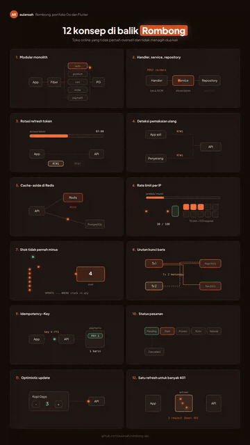
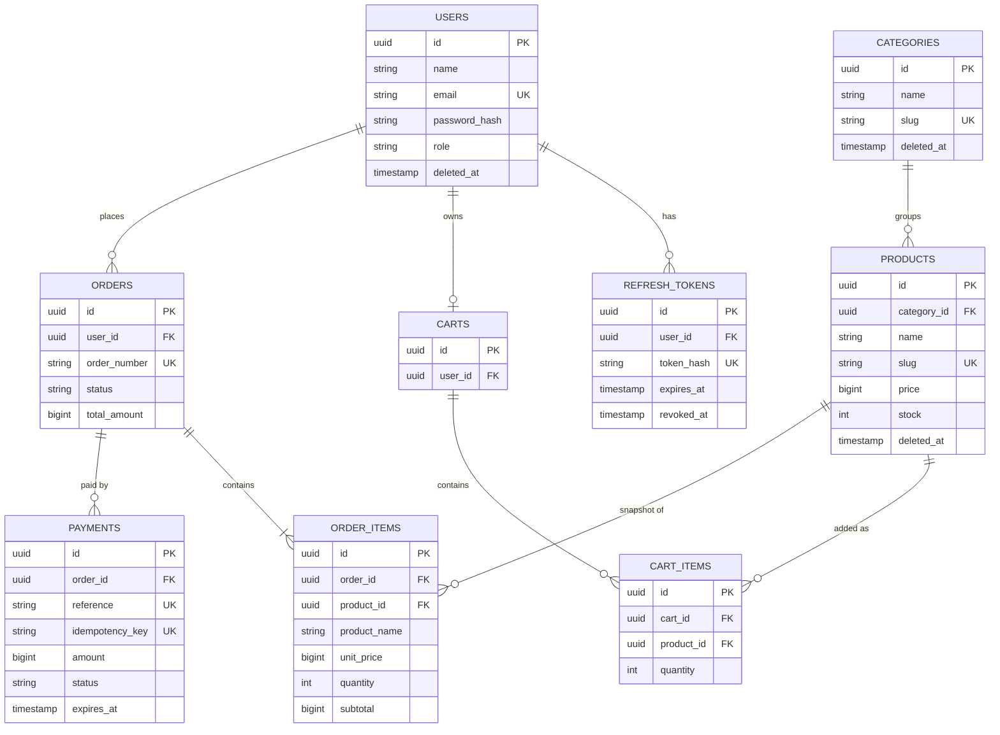
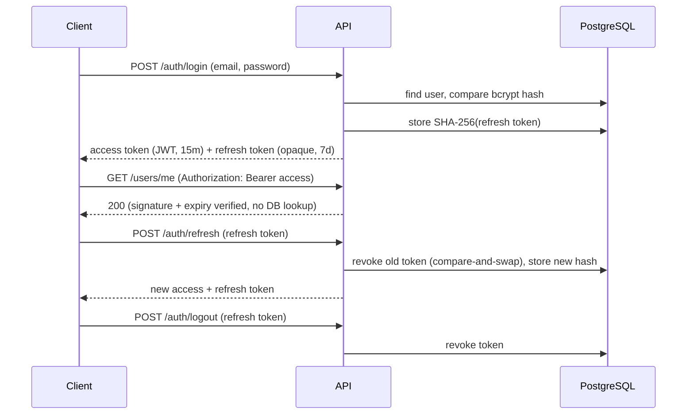
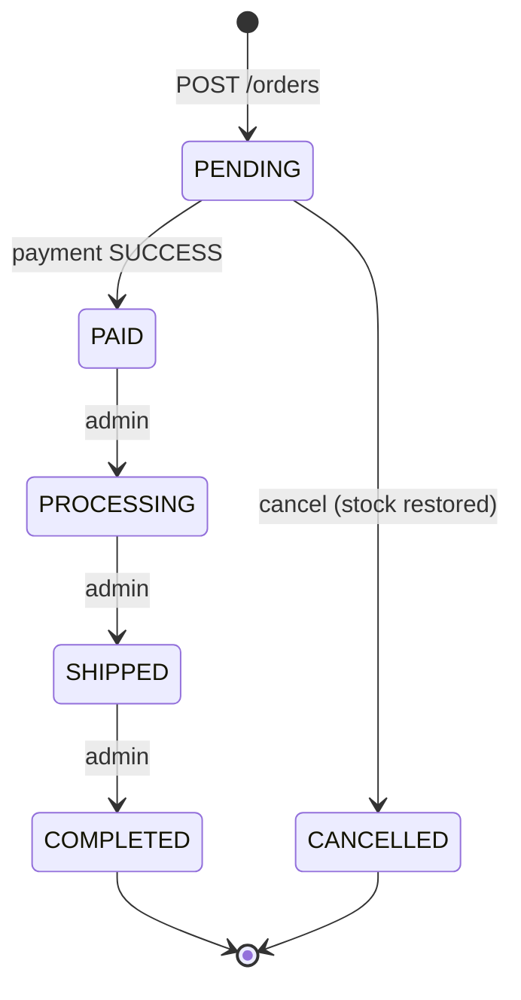

# Rombong API

Rombong ("gerobak" pedagang, sekarang digital) is a production-oriented e-commerce REST API written in Go. It covers the full
purchase path (catalog, cart, transactional checkout, and payment through
Midtrans Snap or a built-in simulator)
with the concerns that matter in a real backend: no overselling under
concurrency, idempotent payments, token rotation, cache invalidation and
consistent error handling.

<p align="center"></p>

Visual docs: [`docs/motion.html`](docs/motion.html) animates the 12 core
mechanisms (also as a [9:16 video](docs/media/rombong-12-konsep-reels.mp4)),
[`docs/engineering-doc.html`](docs/engineering-doc.html) has the FRD/FSD,
system design and test results. The Flutter client lives in
[rombong-app](https://github.com/aulansah/rombong-app); the UI is designed in
[Figma](https://www.figma.com/design/0c97QesZUU2kNCA0ipNoFS).

## Table of contents

- [Business requirements](#business-requirements)
- [Technology stack](#technology-stack)
- [Architecture](#architecture)
- [Project structure](#project-structure)
- [Database design](#database-design)
- [Getting started](#getting-started)
- [Deploying](#deploying)
- [Environment variables](#environment-variables)
- [API documentation](#api-documentation)
- [Authentication flow](#authentication-flow)
- [Order and payment flow](#order-and-payment-flow)
- [Caching strategy](#caching-strategy)
- [Testing](#testing)
- [Git workflow](#git-workflow)
- [Known limitations](#known-limitations)

## Business requirements

| Module | What it does |
|---|---|
| Auth | Register, login, JWT access token, rotating refresh token, logout, role-based access (admin / customer) |
| Users | Own profile, change password; admins can list and view users |
| Categories | Public read; admin create, update, delete |
| Products | Public list with search, category filter, sorting and pagination; admin CRUD and stock management |
| Cart | Add, update, remove, clear; totals computed from current prices |
| Orders | Checkout from cart in one transaction, history, cancel, admin status updates |
| Payments | Simulated gateway: create, succeed, fail, expire; idempotent |

Rules the code guarantees (each one has a test):

- Stock never goes negative, even when many customers buy the last unit at
  the same time.
- A checkout either reserves stock for every item or changes nothing.
- Order items keep the product name and price from the moment of purchase.
- Prices and amounts are never taken from the client.
- A customer can only see their own cart, orders and payments.
- Repeating a payment request never processes the payment twice.

## Technology stack

| Concern | Choice | Version |
|---|---|---|
| Language | Go | 1.24 |
| HTTP framework | Fiber v2 | v2.52 |
| ORM | GORM + pgx driver | v1.31 |
| Database | PostgreSQL | 16 |
| Cache / rate limiter | Redis (go-redis v9) | 7 |
| Auth | golang-jwt v5 (HS256), bcrypt | v5.3 |
| Configuration | Viper | v1.21 |
| Validation | go-playground/validator v10 | v10.30 |
| Logging | Uber Zap (structured JSON) | v1.28 |
| Migrations | golang-migrate (SQL files embedded in the binary) | v4.19 |
| Testing | `testing`, testify, miniredis | — |
| API docs | Hand-written OpenAPI 3 + Swagger UI | — |
| Containers | Docker multi-stage build, Docker Compose | — |

Exact versions are pinned in `go.mod`. They are the newest releases that
still support Go 1.24.

## Architecture

A modular monolith with three layers per module:

```
HTTP request
   │
   ▼
Middleware   request ID → request log → panic recovery → CORS → rate limit → auth → role check
   │
   ▼
Handler      parse + validate input, call the service, build the response
   │
   ▼
Service      business rules and transaction boundaries
   │
   ▼
Repository   the only layer that talks to GORM / PostgreSQL
```

Key decisions:

- **Organized by module, layered inside.** `internal/modules/order` holds the
  order handler, service, repository, model and DTOs. Shared infrastructure
  (config, database, cache, middleware) lives beside the modules.
- **Interfaces are declared by the consumer.** A service defines the small
  interface it needs (`order.StockManager`), and the concrete repository
  satisfies it. That keeps module dependencies one-directional
  (`user ← auth`, `product ← cart ← order ← payment`) and lets unit tests use
  in-memory fakes.
- **Transactions belong to the service layer.** `database.TxManager` puts the
  transaction in the `context.Context`; repositories pick it up with
  `database.FromContext`. Services control atomicity without importing GORM.
- **Manual dependency injection** in `internal/app/app.go`. Every dependency
  is visible in one file and checked by the compiler.
- **One error path.** Repositories return sentinel errors, services convert
  them to `*apperror.AppError`, and a single Fiber error handler renders the
  JSON. Unknown errors are logged with the request ID and returned as a
  generic 500.

## Project structure

```
cmd/api/main.go            entry point: config, migrations, wiring, graceful shutdown
internal/
  app/                     composition root (builds the Fiber app)
  config/                  Viper configuration with fail-fast validation
  database/                PostgreSQL connection, TxManager, migration runner
  cache/                   Redis client behind a small interface
  middleware/              auth, role check, request logging, rate limiting
  routes/                  URL → handler mapping with access rules
  utils/                   validation, pagination, slug helpers
  modules/
    auth/                  register, login, refresh, logout
    user/                  profile, password, admin user queries
    category/              category CRUD
    product/               catalog, stock, cache-aside
    cart/                  shopping cart
    order/                 checkout, cancel, status state machine
    payment/               payment simulation, idempotency
pkg/
  apperror/                application error type and codes
  response/                JSON envelopes and the central error handler
  logger/                  Zap setup
  token/                   JWT issue / verify
migrations/                SQL migrations (embedded)
docs/                      openapi.yaml, Swagger UI page, INTERVIEW.md
tests/                     integration tests (real PostgreSQL)
```

## Database design



Design notes:

- **UUID primary keys** (`gen_random_uuid()`): IDs are not guessable and do
  not reveal how many orders exist.
- **Money is `BIGINT`** in the smallest currency unit. No floats.
- **Normalized to 3NF, with one deliberate exception.** `order_items` copies
  `product_name` and `unit_price`, and `orders` stores `total_amount`: these
  are historical facts, not values derived from the current product.
  The cart is the opposite — it stores no price and always shows the current
  one.
- **Soft deletes** on `users`, `categories` and `products` only. Orders and
  payments are financial records and are never deleted.
- **Partial unique indexes** (`WHERE deleted_at IS NULL`) on `users.email`
  and the slugs, so a soft-deleted value can be reused.
- **`uq_payments_pending_order`**: a partial unique index that allows at most
  one `PENDING` payment per order.
- **CHECK constraints** (`stock >= 0`, `quantity > 0`, valid statuses) are the
  last line of defence if application code is ever wrong.

## Getting started

### With Docker Compose (recommended)

```bash
docker compose up --build -d
curl http://localhost:8080/health
```

This starts the API, PostgreSQL and Redis. Migrations run on startup and an
admin account is created (`admin@example.com` / `Admin12345`; override with
`ADMIN_EMAIL` / `ADMIN_PASSWORD`).

- API: <http://localhost:8080/api/v1>
- Swagger UI: <http://localhost:8080/docs>

### Without Docker

Requires Go 1.24+, PostgreSQL 13+ and Redis.

```bash
cp .env.example .env      # then set JWT_SECRET and the DB credentials
createdb ecommerce
make run
```

### Production build

```bash
make build                           # static binary in bin/api
docker build -t rombong-api .   # minimal image, runs as non-root
```

In production set `APP_ENV=production` (JSON logs), a strong `JWT_SECRET`,
explicit `CORS_ALLOW_ORIGINS`, and consider running migrations as a separate
step (`./api -migrate-only`) with `AUTO_MIGRATE=false`.

## Deploying

`render.yaml` is a [Render Blueprint](https://render.com/docs/blueprint-spec)
that creates the API (from the Dockerfile), PostgreSQL and a Redis-compatible
Key Value store, wired together, with a generated `JWT_SECRET`:

1. Push this repo to GitHub.
2. Render dashboard: **New → Blueprint**, select the repo.
3. Enter `ADMIN_EMAIL`, `ADMIN_PASSWORD` and, for real sandbox payments,
   `MIDTRANS_SERVER_KEY` (then set `PAYMENT_PROVIDER=midtrans`).
4. In the Midtrans dashboard set the notification URL to
   `https://<service>.onrender.com/api/v1/webhooks/midtrans`.

The free plan sleeps after inactivity; the first request after that takes a
few seconds.

## Environment variables

| Variable | Default | Description |
|---|---|---|
| `APP_ENV` | `development` | `production` switches to JSON logs and stricter checks |
| `APP_PORT` | `8080` | HTTP port |
| `LOG_LEVEL` | `info` | `debug`, `info`, `warn`, `error` |
| `AUTO_MIGRATE` | `true` | Apply migrations on startup |
| `BCRYPT_COST` | `12` | Password hashing cost |
| `DB_HOST` `DB_PORT` `DB_USER` `DB_PASSWORD` `DB_NAME` `DB_SSLMODE` | local defaults | PostgreSQL connection |
| `DB_MAX_OPEN_CONNS` / `DB_MAX_IDLE_CONNS` | `25` / `5` | Connection pool |
| `REDIS_ADDR` `REDIS_PASSWORD` `REDIS_DB` | `localhost:6379` | Redis connection |
| `JWT_SECRET` | — (required, ≥ 32 chars) | HMAC signing key |
| `JWT_ACCESS_TTL` / `JWT_REFRESH_TTL` | `15m` / `168h` | Token lifetimes |
| `CORS_ALLOW_ORIGINS` | `http://localhost:3000` | Comma-separated origins; `*` is rejected in production |
| `RATE_LIMIT_ENABLED` `RATE_LIMIT_MAX` `RATE_LIMIT_WINDOW` | `true` `100` `1m` | Per-IP rate limit |
| `CACHE_PRODUCT_TTL` / `CACHE_PRODUCT_LIST_TTL` | `10m` / `2m` | Cache lifetimes |
| `PAYMENT_EXPIRY` | `30m` | How long a payment stays payable |
| `PAYMENT_PROVIDER` | `simulated` | `simulated` or `midtrans` |
| `MIDTRANS_SERVER_KEY` / `MIDTRANS_PRODUCTION` | — / `false` | Midtrans Snap server key; sandbox unless production is `true` |
| `ADMIN_NAME` `ADMIN_EMAIL` `ADMIN_PASSWORD` | — | Seed admin (skipped when empty) |

## API documentation

The full contract is in [`docs/openapi.yaml`](docs/openapi.yaml), served with
Swagger UI at `/docs`.

Access: **P** public, **U** authenticated, **A** admin.

| Method | Path | Access |
|---|---|---|
| POST | `/auth/register`, `/auth/login`, `/auth/refresh` | P |
| POST | `/auth/logout` | U |
| GET, PUT | `/users/me` | U |
| PUT | `/users/me/password` | U |
| GET | `/users`, `/users/:id` | A |
| GET | `/categories`, `/categories/:id` | P |
| POST, PUT, DELETE | `/categories`, `/categories/:id` | A |
| GET | `/products`, `/products/:id` | P |
| POST, PUT, DELETE | `/products`, `/products/:id` | A |
| PATCH | `/products/:id/stock` | A |
| GET, DELETE | `/cart` | U |
| POST | `/cart/items` | U |
| PUT, DELETE | `/cart/items/:id` | U |
| POST, GET | `/orders` | U |
| GET | `/orders/:id` | U (owner or admin) |
| POST | `/orders/:id/cancel` | U (owner or admin) |
| PATCH | `/orders/:id/status` | A |
| POST | `/payments` (requires `Idempotency-Key`) | U |
| GET | `/payments/:id` | U (owner or admin) |
| POST | `/payments/:id/simulate-success`, `/simulate-failure` | U (owner or admin) |
| GET | `/health` | P |

Product list query: `?page=1&limit=20&search=kopi&category_id=<uuid>&sort=price|name|created_at&order=asc|desc`

### Response format

```json
{ "success": true, "message": "Products retrieved", "data": [], "meta": { "page": 1, "limit": 20, "total_items": 42, "total_pages": 3 } }
```

```json
{
  "success": false,
  "message": "Validation failed",
  "error": { "code": "VALIDATION_ERROR", "details": [{ "field": "email", "message": "must be a valid email address" }] },
  "request_id": "0de601fc-611f-4e0c-8b18-a65325c3465b"
}
```

| Status | Code | When |
|---|---|---|
| 400 | `BAD_REQUEST` | Malformed body or ID, empty cart, missing `Idempotency-Key` |
| 401 | `UNAUTHORIZED` | Missing, invalid or expired token |
| 403 | `FORBIDDEN` | Valid token, insufficient role |
| 404 | `NOT_FOUND` | Missing resource, or a resource owned by someone else |
| 409 | `CONFLICT` | Duplicate email, insufficient stock, illegal status change |
| 422 | `VALIDATION_ERROR` | Field validation failed |
| 429 | `TOO_MANY_REQUESTS` | Rate limit exceeded |
| 500 | `INTERNAL_ERROR` | Unexpected error (details only in logs) |

### Example requests

```bash
BASE=http://localhost:8080/api/v1

# Log in as the seeded admin and create catalog data
ADMIN=$(curl -s -X POST $BASE/auth/login -H 'Content-Type: application/json' \
  -d '{"email":"admin@example.com","password":"Admin12345"}' | jq -r .data.tokens.access_token)

CATEGORY=$(curl -s -X POST $BASE/categories -H "Authorization: Bearer $ADMIN" \
  -H 'Content-Type: application/json' -d '{"name":"Minuman"}' | jq -r .data.id)

PRODUCT=$(curl -s -X POST $BASE/products -H "Authorization: Bearer $ADMIN" \
  -H 'Content-Type: application/json' \
  -d "{\"name\":\"Kopi Arabika\",\"price\":85000,\"stock\":10,\"category_id\":\"$CATEGORY\"}" | jq -r .data.id)

# Register a customer, log in, shop
curl -s -X POST $BASE/auth/register -H 'Content-Type: application/json' \
  -d '{"name":"Auldy","email":"auldy@example.com","password":"Secret123"}'

TOKEN=$(curl -s -X POST $BASE/auth/login -H 'Content-Type: application/json' \
  -d '{"email":"auldy@example.com","password":"Secret123"}' | jq -r .data.tokens.access_token)

curl -s -X POST $BASE/cart/items -H "Authorization: Bearer $TOKEN" \
  -H 'Content-Type: application/json' -d "{\"product_id\":\"$PRODUCT\",\"quantity\":2}"

ORDER=$(curl -s -X POST $BASE/orders -H "Authorization: Bearer $TOKEN" | jq -r .data.id)

PAYMENT=$(curl -s -X POST $BASE/payments -H "Authorization: Bearer $TOKEN" \
  -H "Idempotency-Key: $(uuidgen)" -H 'Content-Type: application/json' \
  -d "{\"order_id\":\"$ORDER\"}" | jq -r .data.id)

curl -s -X POST $BASE/payments/$PAYMENT/simulate-success -H "Authorization: Bearer $TOKEN"
curl -s $BASE/orders/$ORDER -H "Authorization: Bearer $TOKEN" | jq .data.status   # "PAID"
```

## Authentication flow



- The **access token** is a stateless JWT (HS256). The accepted algorithm is
  pinned, and issuer and expiry are verified.
- The **refresh token** is 256 random bits. Only its SHA-256 hash is stored.
- Every refresh **rotates** the token. Presenting an already-used refresh
  token is treated as theft and revokes all of that user's sessions.
- Changing the password revokes all refresh tokens.
- Login returns the same error for an unknown email and a wrong password.

## Order and payment flow



**Checkout** (`POST /orders`) runs in a single transaction:

1. Lock the user's cart row (`SELECT … FOR UPDATE`) so a double-click cannot
   create two orders from one cart.
2. For every item, in a fixed order to avoid deadlocks, reserve stock with
   one statement:
   `UPDATE products SET stock = stock - $qty WHERE id = $id AND stock >= $qty RETURNING *`.
   No affected row means insufficient stock → rollback → `409`.
3. Insert the order and its items using the name and price returned by that
   statement.
4. Clear the cart and commit.

**Status changes** are compare-and-swap updates
(`UPDATE … SET status = $to WHERE id = $id AND status = $from`), so racing
requests (cancel vs. pay, two cancels) cannot both win.

**Payments**

| Payment status | Meaning |
|---|---|
| `PENDING` | Waiting for the gateway result |
| `SUCCESS` | Paid; the order moved to `PAID` in the same transaction |
| `FAILED` | Order stays `PENDING`; a new payment can be created |
| `EXPIRED` | Passed `expires_at` before being paid |

Idempotency works on two levels:

- **Creating**: `POST /payments` requires an `Idempotency-Key` header. A
  retry with the same key returns the original payment (`200` instead of
  `201`). A unique index on the key makes this hold under concurrency.
- **Processing**: `simulate-success` moves `PENDING → SUCCESS` with a
  compare-and-swap. Repeated or concurrent calls return the same result and
  the order is marked `PAID` exactly once.

**Payment providers.** `PAYMENT_PROVIDER=simulated` (the default) exposes
`simulate-success` and `simulate-failure` for demos. With
`PAYMENT_PROVIDER=midtrans`:

1. `POST /payments` creates the payment row, then opens a
   [Midtrans Snap](https://docs.midtrans.com/reference/snap-api-overview)
   transaction whose `order_id` is the payment reference and whose amount is
   the order total. The response carries `redirect_url`; the app opens it so
   the buyer pays on the Midtrans page. The gateway call happens after the
   database commit, so a slow gateway never holds a transaction open. If
   Midtrans is unreachable the payment is marked `FAILED` and the API answers
   `502 GATEWAY_ERROR`; the app retries with a new key.
2. Midtrans calls `POST /api/v1/webhooks/midtrans`. The handler verifies
   `signature_key` (SHA-512 of order_id, status_code, gross_amount and the
   server key), checks the amount, and applies the result with the same
   compare-and-swap as above. Midtrans retries notifications; duplicates are
   acknowledged and change nothing.
3. The simulate endpoints answer `403`, so a real payment cannot be faked.

To try it: create a free sandbox account, copy the server key from
*Settings → Access Keys*, set the variables above, and set the notification
URL in the dashboard to `https://<your-host>/api/v1/webhooks/midtrans`
(use a tunnel such as `cloudflared` when running locally).

## Caching strategy

Cache-aside with Redis; PostgreSQL remains the source of truth.

| Data | Key | TTL | Invalidation |
|---|---|---|---|
| Product detail | `product:{id}` | 10 min | Deleted on update, delete, stock change, checkout and cancel |
| Product list | `products:list:v{n}:{hash of query}` | 2 min | Any product write runs `INCR products:list:version`, making all older keys unreachable |

If Redis is slow or down, reads fall back to PostgreSQL, writes still
succeed, the rate limiter lets requests through, and `/health` reports
`degraded`. Client timeouts are 500 ms so a dead cache cannot stall requests.

## Testing

```bash
make test               # unit tests, no external services
make up                 # start PostgreSQL (creates ecommerce_test)
make test-integration   # integration tests against real PostgreSQL
```

| Layer | Location | What is covered |
|---|---|---|
| Unit | `pkg/token` | JWT verification: tampering, expiry, wrong secret, `alg: none` |
| Unit | `internal/modules/auth` | Register, login, refresh rotation and reuse detection, logout (in-memory fakes) |
| Unit | `internal/modules/product` | Cache-aside, versioned list cache, Redis outage fallback (miniredis) |
| Unit | `internal/modules/order` | Status state machine |
| HTTP | `internal/middleware` | 401 vs 403, role checks, rate limiter |
| Integration | `tests/` | Every endpoint through the real router, PostgreSQL and migrations |

Integration tests worth reading first:

- `TestConcurrentCheckoutNeverOversells` — 20 customers race for 5 units;
  exactly 5 orders are created and stock ends at 0.
- `TestConcurrentCheckoutOfSameCartCreatesOneOrder` — a double-submitted
  checkout creates one order.
- `TestPaymentFlow` — idempotency key replay, concurrent creates and
  concurrent `simulate-success`.
- `TestOrderCheckout` — price snapshot, client-supplied prices ignored,
  all-or-nothing rollback.

Integration tests read `TEST_DB_HOST`, `TEST_DB_PORT`, `TEST_DB_USER`,
`TEST_DB_PASSWORD`, `TEST_DB_NAME` (defaults: the Compose PostgreSQL and
`ecommerce_test`). They truncate all tables, so never point them at a
database you care about.

## Git workflow

- `main` — always releasable. `develop` — integration branch.
- One `feature/*` branch per module, merged into `develop` through a pull
  request: `feature/authentication`, `feature/product-management`,
  `feature/shopping-cart`, `feature/order-management`, `feature/payment`,
  `feature/redis-cache`, `feature/testing`.
- Commits follow [Conventional Commits](https://www.conventionalcommits.org):

```
feat(auth): implement JWT authentication with refresh token rotation
feat(order): implement transactional order creation
fix(payment): replay concurrent requests that share an idempotency key
test(order): add concurrent checkout oversell test
docs(readme): document order and payment flow
```

## Known limitations

Deliberate scope cuts, and what a next iteration would add:

- **Midtrans is integrated through Snap and webhooks**, tested against a fake
  Snap server and signed notifications. A scheduled reconciliation job that
  polls the Midtrans status API would cover missed webhooks.
- **Expired payments are detected lazily** (when accessed), and unpaid orders
  are not cancelled automatically. A background worker would do both.
- **No refund flow**, so paid orders cannot be cancelled.
- **Access tokens cannot be revoked** before they expire (15 minutes). A
  Redis deny-list would close that window.
- **Rate limiting is per IP with a fixed window.** Behind a proxy, configure
  trusted proxy headers; a sliding window would smooth bursts.
- **Search uses `ILIKE`.** A `pg_trgm` index or full-text search would be the
  next step for a large catalog.
- **`PUT /products/:id` sets stock absolutely.** Concurrent with a checkout
  it can overwrite a decrement; `PATCH /products/:id/stock` has the same
  caveat. A relative "adjust stock" endpoint would avoid it.
